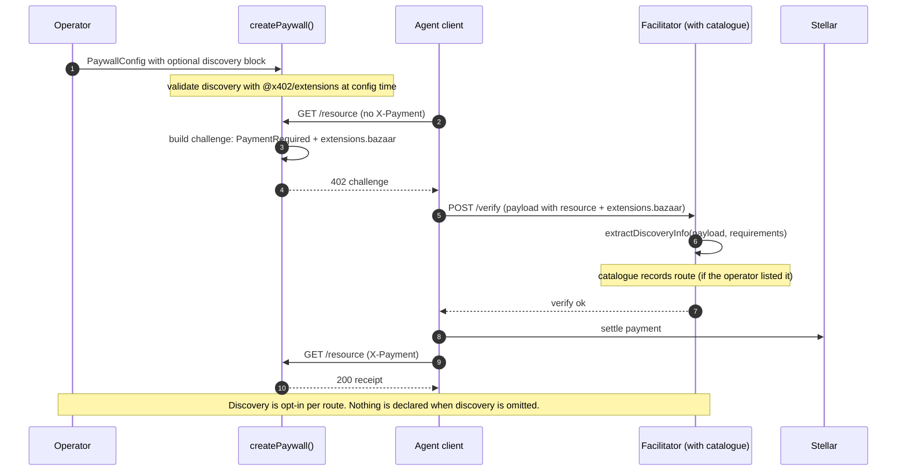

# ADR: Publish paywalled routes through the x402 Bazaar discovery extension

- **Status:** Proposed, awaiting maintainer approval
- **Date:** 2026-11-19
- **Issue:** #154
- **Scope:** `packages/server` `PaywallConfig` and facilitator payload shape. Depends on the `@x402/core`, `@x402/stellar` and new `@x402/extensions` 2.31.0 upgrade (either from #153 or carried in this PR). Four adapters inherit the change through their shared gate. A small helper or documented recipe sits in `packages/client` (or docs only) for listing a facilitator's catalogue. `apps/web` gets a docs page. No change to receipts, policy, or any payment-path state machine.

## Context

`PaywallConfig` (`packages/server/src/gate.ts` lines 39 to 51) has no descriptive metadata today:

```ts
export type PaywallConfig = {
  amount: string;
  asset: string;
  payTo: string;
  network: StellarNetwork;
  models?: SettlementModel[];
  resource?: string;
  facilitatorUrl?: string;
};
```

The 402 challenge is Tollway's own `PaymentOffer`. #43 moves the gate to the x402 V2 `PaymentRequired` / `PaymentPayload` shape; this ADR builds on top of that wire format.

Upstream, `@x402/extensions` 2.31.0 exposes exactly what the issue asks for, with validators we can run at config time and at test time:

- `declareDiscoveryExtension(config)` produces `PaymentRequired.extensions.bazaar`. For a query route the input is `{ method, input, inputSchema, pathParams, output }`; a body route adds `bodyType: "json" | "form-data" | "text"`; MCP tools have their own shape.
- `bazaarResourceServerExtension.enrichDeclaration` adds method and normalised route template from transport context.
- On the facilitator side, `extractDiscoveryInfo(paymentPayload, paymentRequirements)` reads `paymentPayload.resource.url` and `paymentPayload.extensions.bazaar` at settle time. A facilitator that runs a catalogue reads these two fields from the payload Tollway hands it.
- `withBazaar(new HTTPFacilitatorClient(...))` adds `extensions.bazaar.listResources()` (`GET <facilitator>/discovery/resources`) and `search()` (`GET <facilitator>/discovery/search`) for the agent side.
- `isValidRouteTemplate` is exported and validates `:param` templates. Path parameters that identify a user are an operator concern; the validator does not know that, so the docs call it out.

Today Tollway's facilitator adapter builds the `/verify` and `/settle` payload itself (`packages/server/src/facilitator.ts` `toPayload`, line 151):

```ts
return {
  x402Version,
  accepted: requirements,
  payload: { transaction: payment.paymentSignature } satisfies ExactStellarPayloadV2,
};
```

There is no `resource`, no `extensions`. Even a correct declaration on the 402 challenge would not reach the facilitator's catalogue, because the catalogue reads the payload, not the challenge.

Discovery is a privacy decision. Tollway must not publish a route the operator did not ask to publish. The default stays "nothing is declared".

Tollway is not a facilitator. `docs/design.md`, "What Tollway is not", is the written rule. We do not run a catalogue in Tollway or mimic one; we publish for facilitators that do.

`docs/design.md` open question 3 ("What is the x402 V2 service-discovery format, and should Tollway consume it for routing hints?") is answered for the publishing side here. For the consuming side the honest answer today is "not yet", and this ADR records that with a reason.

## Decision

1. **Add an optional discovery block to `PaywallConfig`:**
   ```ts
   discovery?: {
     description?: string;
     mime?: string;
     method?: "GET" | "POST" | "PUT" | "PATCH" | "DELETE";
     routeTemplate?: string; // ":param" segments, validated by isValidRouteTemplate
     input?: { kind: "query"; shape: Record<string, unknown>; path?: string[] }
           | { kind: "body"; bodyType: "json" | "form-data" | "text"; schema?: unknown };
     output?: { mime?: string; schema?: unknown; example?: unknown };
   };
   ```
   Routes without a `discovery` block behave exactly as today and publish nothing. `createPaywall` runs `@x402/extensions`' own validator at construction time and throws a typed `TollwayError` on invalid declarations so bad config fails loud and early.

2. **Build `extensions.bazaar` through the upstream helper.** When `discovery` is set, the gate calls `declareDiscoveryExtension(...)` and lets `bazaarResourceServerExtension.enrichDeclaration` add method and route template from the transport context the adapter already has. The result is attached to the 402 challenge in the V2 `PaymentRequired` shape added by #43.

3. **Carry `resource` and `extensions.bazaar` through to `/verify` and `/settle`.** `toPayload` in `packages/server/src/facilitator.ts` grows a `resource: { url }` field and, when the matched route had a `discovery` block, the `extensions.bazaar` built at step 2. A test runs the real `extractDiscoveryInfo` over the payload we built and asserts the same object comes back.

4. **Opt-in and operator-driven.** The default is no discovery. Operators enable it per route. The docs page spells this out and includes a warning about route templates that could leak identifiers.

5. **Expose a thin agent-side listing recipe.** Either a small helper in `packages/client` (`listCatalogue(facilitatorUrl)` wrapping `withBazaar(...).extensions.bazaar.listResources()`) or a documented five-line recipe in `apps/web/src/content/docs/discovery.mdx`. The maintainer picks which at review; both options schema-validate the response at the boundary (Directive defect checklist item 1). The wrapper does not retry and does not cache.

6. **Do not consume discovery for routing hints in the router.** `docs/design.md` open question 3 is updated to answer the publish side with the shape above, and the consume side with "not yet". Reason: the router today picks between `x402` and `mpp-channel` from the policy and from the offer itself; using a counterparty's catalogue to influence routing would introduce a new trust assumption (that a listed resource is still the one the agent means to pay for) without a corresponding integrity check, and the upstream catalogue is new enough that we want operator evidence before writing policy against it.

7. **Upstream upgrade.** `@x402/core` and `@x402/stellar` go to 2.31.x (matching `@x402/extensions` 2.31.0). If #153 lands first it will have done this; otherwise this PR does it. The upgrade is tracked as a separate commit so a bisect can pin problems to the upgrade or the feature independently.

## Diagram



## Consequences

- `PaywallConfig` grows one optional field. Existing operators see no behavioural change. A changeset captures the bump; a release note explains how to opt in.
- The `/verify` and `/settle` payload grows `resource` and sometimes `extensions.bazaar`. Facilitators that do not care about discovery ignore both. Facilitators that catalogue get what they need.
- The agent-side listing recipe lives behind a thin wrapper or in docs. No new long-lived state inside Tollway.
- The upstream upgrade is coordinated with #153. If both land in the same wave, the upgrade commit appears once.
- Open question 3 in design.md gets a decision rather than an open row.

## Alternatives considered

- **Emulate a catalogue in Tollway.** Rejected. That makes Tollway a facilitator, which design.md excludes.
- **Publish by default.** Rejected. Discovery leaks route shape and parameters; it must be an operator choice.
- **Hand-roll the bazaar shape.** Rejected. Upstream ships the builder, the enricher, and the validator; re-implementing invites drift.
- **Publish on the challenge only, not the payload.** Rejected. Catalogues read the payload; publishing only on the challenge does not reach them.
- **Make the agent-side listing part of the client proper.** Rejected for v1. A thin helper or recipe keeps the client's surface small and avoids owning a cache for third-party data.

## Verification

- A unit test that a query-route `discovery` config produces an `extensions.bazaar` that `validateDiscoveryExtension` accepts, and a JSON-body route the same.
- A unit test that a route without `discovery` has no `extensions.bazaar` on either the challenge or the payload.
- A test that round-trips through `extractDiscoveryInfo` over the payload `createHttpFacilitator` sends, with a stubbed fetch.
- A test that an invalid declaration throws at `createPaywall` time, not at request time.
- Boundary tests for a malformed `/discovery/resources` response (schema check rejects, no partial results leak).
- A test that `isValidRouteTemplate` rejects a parameter name the docs call out as sensitive.
- `./scripts/preflight.sh` must pass.
