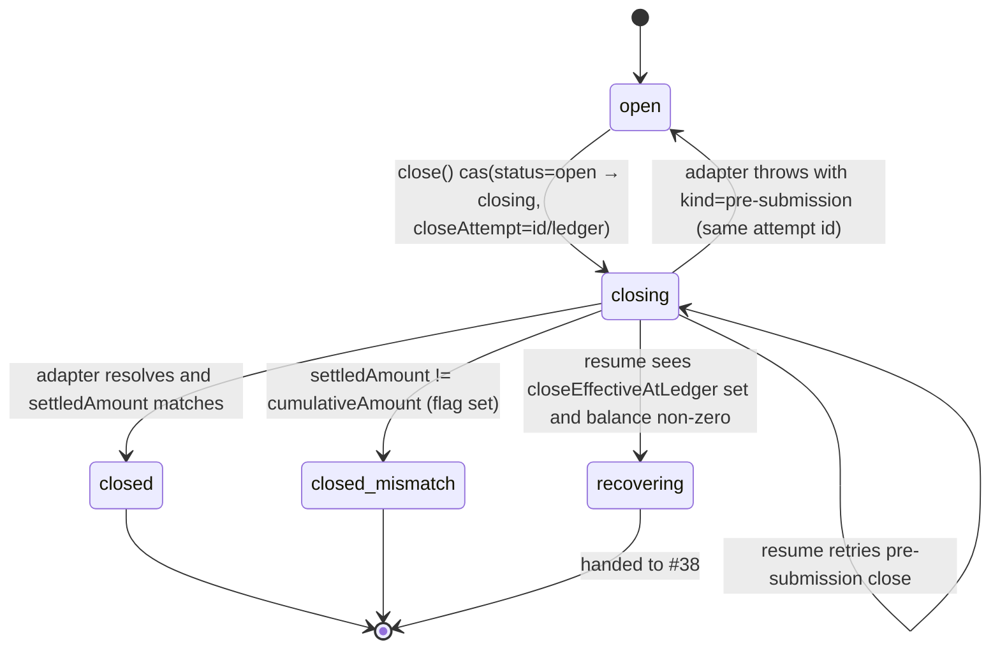

# ADR: Make channel close crash-safe and resume stuck channels from chain state

- **Status:** Proposed, awaiting maintainer approval
- **Date:** 2026-11-19
- **Issue:** #176
- **Scope:** `packages/channels` manager, adapter interface, types, errors, index, tests. `docs/design.md` open question 1 is updated. The real adapter against `@stellar/mpp` is still #101; this ADR specifies the surface tightly enough for #101 to implement and adds the test-double implementation here.

## Context

`ChannelManager.close` in `packages/channels/src/manager.ts` has three defects.

1. **Interrupted close leaves the channel in `closing` forever.** `close()` writes `status: "closing"` with `await store.updateChannel(channelId, { status: "closing" })` before awaiting `adapter.closeChannel(...)`. If the process dies between those two lines (or inside the adapter call), nothing ever leaves `closing`:
   - `shouldClose()` returns `false` for any non-open channel (early return in the method body).
   - `commit()` throws when the channel is not `open`.
   - `close()` itself throws `ChannelAlreadyClosedError(channelId, "closing")` because it rejects any status other than `open` at the top.
   There is no API that advances a channel out of `closing`.

2. **Adapter error rolls the channel back to `open`.** The `catch` after `adapter.closeChannel` writes `status: "open"` and rethrows. The comment claims the adapter is responsible for not leaving a half-submitted tx on chain, but the real primitive can not guarantee that: `close` in `@stellar/mpp/channel/server` 0.7.1 broadcasts and then polls, and `pollTransaction` throws `PollTimeoutError` / `PollMaxAttemptsError` when it cannot confirm. Those errors mean "submitted, outcome unknown". Rolling back to `open` on an unknown outcome permits a second commit on a channel the chain may already consider closed.

3. **`SettlementMismatchError` rolls back to `open` too.** After the adapter reports a settled amount that does not match the last commitment, the manager writes `open`, throws, and the channel is committable again. That is backwards: the chain has already acted, so the record needs to reflect that and be flagged for review, not reopened.

Neither the manager nor the adapter interface (`packages/channels/src/adapter.ts`, `MppChannelAdapter`) today has a read-only chain query. `OpenAdapterInput`, `SignCommitmentInput`, and `CloseAdapterInput` plus their results are the full surface, and all of them submit (except `signCommitment`, which simulates).

On the chain side, `@stellar/mpp` 0.7.1 does expose what we need:

- `getChannelState({ channel, network, rpcUrl })` returns `balance`, `closeEffectiveAtLedger` (set once `close_start` has been called or `close` has settled), and `currentLedger`.
- `watchChannel({ channel, startLedger, onEvent, ... })` decodes the contract's `open`, `close`, `withdraw`, `refund` events with `txHash` and `ledger`, and can start from a past ledger. RPC providers keep events for a bounded window; that is a constraint we honour in the recovery path.

`docs/design.md` open question 1 still records an answer against `@stellar/mpp` 0.6.0 (`claim` gated by `closeEffectiveAtLedger` plus a `fundWaitingPeriod`). 0.7.1 does not export `claim`, `close_start`, or `refund` helpers in the same shape; the contract events are `close` and `refund`. That text is stale and this ADR lands the update as part of the change.

Funder-initiated recovery (`close_start`, waiting period, refund) is #38. This ADR detects that case and hands the channel over; it does not implement recovery.

Store-level compare-and-set is #175. The resume path needs it to be safe across two processes; if #175 has not landed, this ADR adds the smallest piece of compare-and-set to `CommitmentStore` it needs (an optimistic `updateChannel(id, expect: Partial<Channel>, next: Partial<Channel>)`), and #175 generalises it. Coordination with #175 is a maintainer call; the default here is to add the minimal variant and defer.

## Decision

1. **Record a close attempt before calling the adapter.** `close()` writes `{ status: "closing", closeAttempt: { id: uuidv4(), startLedger: await adapter.getCurrentLedger(network) } }` through a compare-and-set that requires the previous status to be `open`. The attempt id is the idempotency key for the submission; the ledger is the lower bound for the event scan during resume.

2. **Stop rolling back to `open` on adapter error.** When `adapter.closeChannel` throws, the channel stays in `closing` with the attempt recorded, and the error is annotated with `kind: "submitted-unknown" | "pre-submission"`. The adapter is the only caller that knows which one it is, so the adapter returns the kind on throw (a typed `CloseAdapterError`). Only `pre-submission` is allowed to transition back to `open`, under the same compare-and-set. Everything else waits for `resume`.

3. **Extend `MppChannelAdapter` with read-only chain queries.**
   ```ts
   getChannelState(input: { channelId: string; network: StellarNetwork }):
     Promise<{ balance: string; closeEffectiveAtLedger: number | null; currentLedger: number }>;

   findSettlement(input: { channelId: string; network: StellarNetwork; startLedger: number }):
     Promise<{ txHash: string; settledAmount: string; returnedRemainder: string } | null>;
   ```
   Both are documented with TSDoc as read-only and never submit a transaction. The test-double implementation ships here; the real adapter is #101 and inherits the TSDoc contract.

4. **Add `resume(channelId)`.** On a `closing` channel, resume reads chain state once and branches:
   - Close not visible on chain and `closeEffectiveAtLedger` is null, so the close was pre-submission and never landed. Resume retries `closeChannel` under the same attempt id (adapter treats same id as idempotent). If the adapter still reports pre-submission, resume returns the channel to `open`.
   - Close landed and `balance` is zero. Resume calls `findSettlement` from the recorded `startLedger`, writes `status: "closed"`, `settlementTxHash`, `returnedRemainder` and clears the attempt. Idempotent.
   - `closeEffectiveAtLedger` is set and `balance` is non-zero. This is a funder-initiated close (or dispute). Resume transitions the channel to `recovering` with the detected `closeEffectiveAtLedger` and hands off to #38; it does not call `refund` or settle itself.
   - `findSettlement` returns null because the RPC event window has passed. Resume fails loudly with a typed `ResumeEventWindowExpiredError` and leaves the channel in `closing`. Masking this as `closed` would be exactly what Directive 4 forbids.

5. **`resume` is idempotent.** Two concurrent resumes, or one across two processes sharing the store, perform at most one submission. The compare-and-set from decision 1 is the lock; everything the adapter does for the same attempt id uses the adapter's own idempotency (same payload, same result).

6. **`resumeAll()`** enumerates channels in `closing` through `store.listChannels({ status: "closing" })` and runs `resume` per channel, reporting `{ channelId, outcome }` for each. Failures are collected and returned rather than stopping the pass. If `listChannels` does not exist on the store yet (owned by #179), this ADR adds it with the smallest surface needed and coordinates in #179 to promote it.

7. **Settlement mismatch becomes terminal.** When `adapter.closeChannel` resolves but `settledAmount !== cumulativeAmount`, the channel transitions to `closed` with a new `mismatchFlag: true` and the raw settlement captured. A terminal flag is the right place: the chain has acted and there is nothing to retry. Commits are already blocked by status; the reconcile engine in #50 surfaces the flag.

8. **Update `docs/design.md` open question 1** to reflect `@stellar/mpp` 0.7.1's actual surface: no `claim` or `close_start` helper; events are `close` and `refund`; recovery is funder-initiated through `#38`.

## Diagram



## Consequences

- The `MppChannelAdapter` interface grows by two read-only methods and one typed error; all adapter implementations must gain them. The test double ships here. #101 inherits the TSDoc.
- The `Channel` type grows `closeAttempt?: { id: string; startLedger: number }` and `mismatchFlag?: boolean`. Both are optional and additive.
- A crashed close is now recoverable from the next process start plus a `resumeAll`. Operators who run a single instance can wire this into boot. Multi-instance deployments depend on #175 for the compare-and-set to work across processes; this ADR adds the smallest piece we need.
- The adapter is required to be honest about whether it submitted. That is a contract change but matches what the real `@stellar/mpp` 0.7.1 actually reports through its error types.
- `docs/design.md` open question 1 gets a correct answer against a current dependency version.

## Alternatives considered

- **Keep rolling back on adapter error.** Rejected. It is the source of defect 2 and can double-count a settled channel.
- **Scan the chain on every close call, not just on resume.** Rejected. Close itself does not need this (it holds the lock and runs the adapter once); only recovery from an unknown state does. Doing it twice is wasted RPC.
- **Put resume logic in the adapter.** Rejected. The manager owns sequencing and persistence; the adapter owns primitives. Resume needs the store (`closeAttempt`, status transitions), which is manager territory.
- **Use an in-process queue for serialization.** Rejected. It does not survive a restart, which is exactly the failure this ADR exists to fix. Compare-and-set in the store is the right primitive.
- **Mark mismatches as `open` with a flag.** Rejected. The chain has acted; letting the channel accept a new commit after the chain closed it is the shape of the current bug.

## Verification

Red first for the three defects named in the issue:

1. A fake adapter that records a submission and then throws a poll-timeout-shaped error. Assert the current manager cannot recover (`close` throws `ChannelAlreadyClosedError` and `shouldClose` returns false), then show `resume` landing the channel at `closed` with the right hash and remainder.
2. An adapter that throws before submission with `kind: "pre-submission"`. Assert the channel returns to `open` and the attempt is cleared.
3. An adapter that resolves with a mismatching `settledAmount`. Assert the channel ends at `closed` with `mismatchFlag: true`, not back at `open`.

Also:

- One test per chain-state branch of `resume`: pre-submission retry, settled zero balance, closeEffectiveAtLedger with non-zero balance (recovery handoff), expired event window.
- Idempotency: run `resume` twice concurrently against a shared fake store, assert at most one adapter submission and the same final state.
- `resumeAll` with mixed results: one `closed`, one `recovering`, one `ResumeEventWindowExpiredError`. Assert all three channels are visited and the error channel reports per-channel.
- A crash simulation that discards the manager instance after writing `closing` and before adapter resolves; a new manager over the same store calls `resumeAll` and reaches the right terminal state.

All in `packages/channels/src/channels.test.ts`. `./scripts/preflight.sh` must pass.
