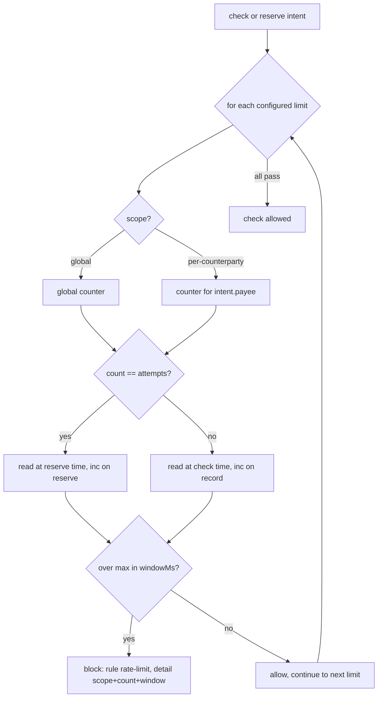

# ADR: Rate-limit semantics: explicit count, scope and window with bounded memory

- **Status:** Proposed, awaiting maintainer approval
- **Date:** 2026-11-19
- **Issue:** #197
- **Scope:** `packages/core` policy schema and engine. `apps/web` docs update. No change to the server gate (service-side rate limiting is #160) or any adapter.

## Context

The documented `rateLimit.requestsPerMinute` and its implementation disagree with themselves in three ways.

Schema and docs (`packages/core/src/policy.ts` line 30, `apps/web/src/content/docs/policy.mdx`):

```ts
rateLimit?: { requestsPerMinute?: number };
```

`policy.mdx` says "sliding-window cap. The window is one minute."

Engine (`packages/core/src/policy.ts`):

- `requestTimestamps: number[]` at line 77 is a single global array.
- It is only appended from `applyRecord` (line 94), which runs from `record()` after a successful settlement. A blocked attempt, a failed settlement, and any in-flight attempt that never records does not count.
- `check()` at line 182 reads `requestTimestamps.length` after `pruneWindow(now)` (line 104). Because `check()` and `record()` do not share a reserve step, concurrent attempts can all pass the last slot. This is the same race #189 fixes for budgets.
- `pruneWindow` uses a hard-coded `60_000` ms cutoff, so the window is not configurable.
- `pruneWindow` also prunes `anomalySamples`, which couples two unrelated rules. A change to one rule's window would silently change the other's.
- The array is global. Ten requests to ten different services count as ten against one limit, even though `perService` elsewhere in the same engine (line 167) scopes caps by `intent.payee`.

`docs/design.md`, "The model router", measures traffic "from a rolling counter per counterparty". A global rate limit disagrees with that mental model; it also makes the limit easy to burn by accident when one noisy counterparty crowds out everything else.

`check()` and `record()` not sharing state is what #189 addresses with a reserve step. This ADR only commits to doing the right counting at reserve time once that seam exists; it does not redesign the seam.

A bucketed accumulator is already in scope for #192 (anomaly rule). If it lands first this ADR uses it; if this lands first #192 reuses the shape added here.

## Decision

1. **Extend the `rateLimit` schema** in `packages/core/src/policy.ts`:
   ```ts
   rateLimit?: Array<{
     count: "attempts" | "settlements";
     scope: "global" | "per-counterparty";
     max: number;
     windowMs: number;
   }>;
   ```
   Accept a shorthand object for a single limit and the legacy `{ requestsPerMinute: N }`, both parsed into the array form at config load. The legacy shorthand maps to `{ count: "settlements", scope: "global", max: N, windowMs: 60_000 }` so today's behaviour is the default.

2. **Count at reserve time, not record time.** When #189's reserve step is in place, attempt-scoped limits increment inside `reserve(intent)` and decrement when a reservation is released without a settlement. Settlement-scoped limits still increment at `record()`. Concurrent attempts can no longer all pass the last slot.

3. **Per-counterparty scope is keyed by `intent.payee` only.** No resource path mixed in; that matches `perService` and matches the design.md phrasing.

4. **Bounded memory.**
   - Hard cap on tracked counterparty keys, default 1024, configurable.
   - Idle counterparties (no activity for `2 * windowMs`) are evicted on the next access, so a short window does not leak keys forever.
   - When the cap is reached, the engine fails closed: a new counterparty key cannot be added, which blocks the attempt with rule `rate-limit-full` and a detail explaining the cap. This matches Directive 4: a fallback that silently accepted would hide pressure that an operator must see.

5. **Window representation.** For short windows (`windowMs <= 5 * 60_000`) use a sliding log of timestamps per key. For longer windows use a two-bucket sliding-window approximation (current bucket plus the fractional overlap of the previous bucket), which is O(1) per check and errs toward blocking by rounding the overlap up. The exact threshold is documented and the two paths share a test fixture that pins the error bound.

6. **Several limits compose.** The engine evaluates every configured limit in order and blocks on the first that would be exceeded. Decision detail names the scope, counterparty (when scoped), count, and window.

7. **Decouple from anomaly.** The rate-limit prune window stays with rate-limit state; anomaly keeps its own prune. `pruneWindow` becomes two functions, one per rule.

8. **Docs.** `apps/web/src/content/docs/policy.mdx` restates exactly what is counted, when the counter advances, what the scope keys off, and includes a worked example (two counterparties, a `2 per 60s` attempts rule, one blocked and one allowed).

## Diagram



## Consequences

- The `Policy` type changes shape. The legacy shorthand keeps old configs working without a flag day. Changeset captures the version bump; release note documents the migration.
- Operators who set only a global limit today keep today's behaviour. New operators can mix rules like `60 per minute per counterparty` and `1000 per hour global` without extra engine wiring.
- Bounded memory means a flood of unique counterparties can get blocked by `rate-limit-full`. That is on purpose: better a loud block than a silent drift into unbounded state.
- Attempt-scoped counting ties this issue's correctness to #189 landing. If #189 slips, settlement-scoped limits still work; attempt-scoped limits warn at config load until the reserve seam is available.
- Decoupling from anomaly's prune path makes future changes to either rule safe in isolation.

## Alternatives considered

- **Keep one array, add a key.** Rejected. Growing the array per counterparty keeps the race and inherits the unbounded growth problem.
- **Redis or shared state.** Rejected. The engine is in-memory by design (`packages/core/src/policy.ts` doc comment, line 72). A shared counter is a separate decision tied to multi-process deployments and belongs with the service-side rate-limit issue #160.
- **Token bucket.** Rejected for this issue. Token buckets are great for bursty APIs but hide the exact-N-in-window semantic the docs already promised; it also forces operators to think in two parameters (rate and burst) where the current API asks for one.
- **Infer scope from resource path.** Rejected. The counterparty is the payee; a path can route to any number of counterparties and mixing them in would mis-scope the counter.

## Verification

Red first for the three defects the issue names:

1. Attempts that never record do not count today. Add a test that drives two blocked attempts and one allowed attempt with `count: "attempts"`; assert the allowed one is blocked when the cap is set to 2.
2. Global scope miscounts across payees. Add a test with `scope: "per-counterparty"` that interleaves calls across two payees and asserts each one is limited independently.
3. `pruneWindow` coupling with anomaly. Add a test that configures a short rate-limit window and a long anomaly window, drives traffic, and asserts anomaly state is untouched when rate-limit state is pruned.

Also:

- A concurrency test against the last slot using an injected clock and `Promise.all`; only one wins.
- An eviction test for idle counterparties and the key cap, covering the fail-closed path.
- Composition: one global and one per-counterparty rule together, assert the first-to-exceed is the one named in `detail`.
- Edge-of-window arithmetic for both the log and the two-bucket paths, with the error bound asserted for the approximation.

All in `packages/core/src/policy.test.ts`. `./scripts/preflight.sh` must pass.
